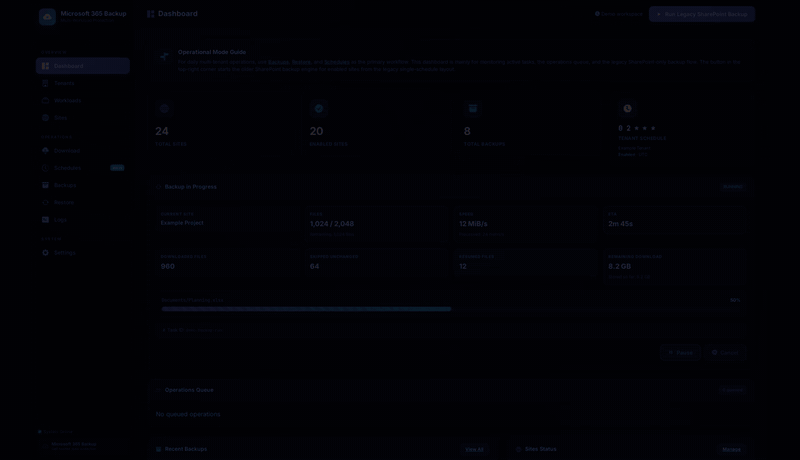
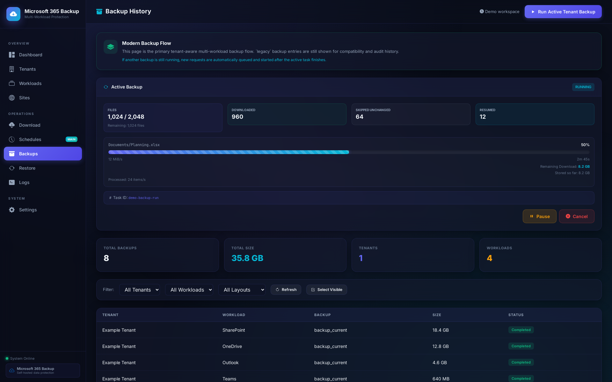
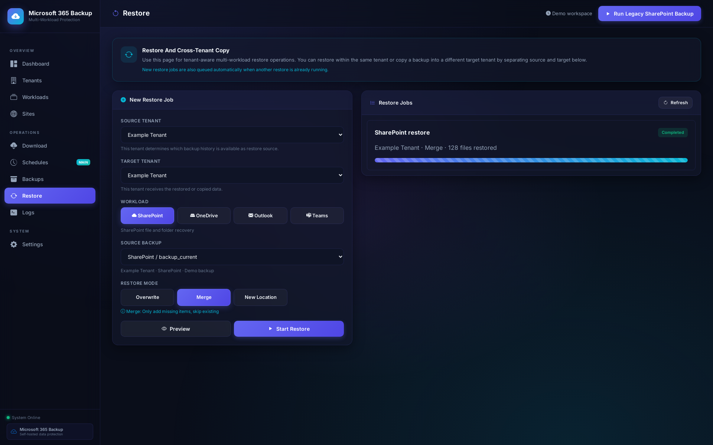
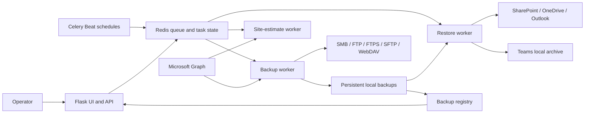

<div align="center">

# Microsoft 365 Backup

### Your Microsoft 365 data. Your infrastructure. One operational dashboard.

Self-hosted backup for **SharePoint, OneDrive, Outlook, and Teams**, with background jobs, tenant-aware schedules, recovery workflows, and remote archive destinations.


**[Get Started](#quick-start)** &nbsp; | &nbsp; **[Watch the Tour](#product-tour)** &nbsp; | &nbsp; **[Explore Features](#capabilities)** &nbsp; | &nbsp; **[Contribute](#build-with-us)**

[Download Source](https://github.com/wahyubudiprastowo/Microsoft365-Backup/archive/refs/heads/main.zip) &nbsp; / &nbsp; [Fork on GitHub](https://github.com/wahyubudiprastowo/Microsoft365-Backup/fork) &nbsp; / &nbsp; [Report an Issue](https://github.com/wahyubudiprastowo/Microsoft365-Backup/issues)

</div>


## Backup Operations You Can See

Keep backup files on storage you control and manage daily operations through a web interface. Choose tenants and targets, queue work in the background, inspect transfer progress, and recover files from a backup inventory.

| Control your data | Keep operations visible | Extend the platform |
| --- | --- | --- |
| Run on your own Docker host with persistent local storage and optional remote copies. | Follow job state, processed files, transfer speed, ETA, history, and logs. | Inspect Python workload modules, add integrations, and contribute focused patches. |

## Product Tour

[](docs/assets/product-tour.mp4)

**[Watch or download the MP4 tour](docs/assets/product-tour.mp4)** · 18 seconds · Dashboard → Backups → Restore

The tour is a slideshow of application templates rendered with synthetic demo data, not a live recording. No tenant connection, production screenshot, customer record, or runtime log is used. Sample counters are illustrative, not performance benchmarks. See the capability matrix below for current workload support.

<details>
<summary><strong>Explore the PNG screenshot gallery</strong></summary>

### Dashboard and Live Progress

Track the current site, file counts, throughput, ETA, and pause/cancel controls.


### Backup Inventory

Review available backup sources before downloading or restoring data.



### Restore Workspace

Select a backup source, review destination settings, and inspect recovery jobs.



</details>

## Capabilities

### Four Workloads, Explicit Recovery Support

| Workload | Backup coverage | Recovery behavior |
| --- | --- | --- |
| **SharePoint Online** | Selected sites and document libraries; files and folders | Upload backed-up files to a target site, library, and folder |
| **OneDrive for Business** | Discovered or selected user drives; files and folders | Restore to mapped users, including nested destination folders |
| **Outlook / Exchange Online** | Accessible cloud mailbox messages, file attachments, calendar, and contacts | Recreate supported items; messages go to an `M365 Restored` folder; write permissions required |
| **Microsoft Teams** | Teams metadata, members, owners, channels, messages, replies, tabs, apps, and channel files | Export a local HTML, JSON, or text archive with channel files |

Teams recovery currently produces an archive; importing that archive back into Microsoft Teams is not implemented. Outlook recovery is item-based, with direct file-attachment uploads below 3 MB; large or unsupported attachments are reported as failures. Private Teams chats and full-fidelity mailbox recovery are outside current coverage.

### Built for Daily Operations

- **Tenant-aware management:** separate tenant connections, workload selection, targets, schedules, and notification recipients.
- **Background execution:** Celery workers process long jobs, with dedicated restore and site-estimate queues.
- **Progress visibility:** renewed Redis task markers and worker-state recovery help keep long-running backups visible after the original 24-hour marker lifetime.
- **Transfer integrity:** size checks reject incomplete transfers; the SharePoint engine also supports resumable transfers, unchanged-file handling, and parallel ranges for large downloads.
- **Recovery planning:** source validation, user mapping, destination selection, dry-run previews, and permission preflight.
- **Honest outcomes:** failed items produce partial or failed results instead of a blanket completed status.
- **Asynchronous site estimates:** refresh sizes in the background and inspect errors for unavailable sites.
- **Notifications:** configure email, Telegram, and Teams transport with tenant-specific recipients.
- **Application access control:** admin authentication protects the UI and administration APIs; configuration responses mask sensitive values.

### Remote Archive Destinations

Keep local backup data and optionally upload a copy after a backup completes.

| Destination | Supported configuration |
| --- | --- |
| **SMB / CIFS** | Windows or NAS share, credentials, and remote path |
| **FTP / FTPS** | FTP server, optional TLS, credentials, and remote path |
| **SFTP / SSH** | Password or private key, with host-key verification |
| **WebDAV** | WebDAV endpoint, credentials, and remote path; compatible Nextcloud and ownCloud deployments |

Each destination has a workload checklist. Connection tests verify write access with a temporary probe file. Upload results report failures per destination, and transfer-size verification is used where the protocol/server exposes it. Remote destinations currently receive the selected workload backup directory; restoring directly from remote storage is not implemented.

## Quick Start

You need a Linux Docker host with Docker Compose, an Entra application registration, and enough writable storage for the data you select.

### 1. Clone and Prepare

```bash
git clone https://github.com/wahyubudiprastowo/Microsoft365-Backup.git
cd Microsoft365-Backup/spo-backup-final
cp .env.example .env
```

### 2. Set Your Credentials

Edit `.env` before starting. Set a unique `SECRET_KEY` and a strong `SPO_ADMIN_PASSWORD`. The UI username defaults to `admin` and the web port defaults to `5050`.

```bash
openssl rand -hex 32
nano .env
```

Use the generated value for `SECRET_KEY`; set a separate password for the admin account. The example configuration contains placeholders, not working Microsoft 365 credentials.

### 3. Install and Open

```bash
sh install-fixed.sh
```

The installer creates persistent directories, copies the configuration template when needed, sets ownership for the default UID/GID `1000:1000`, and builds the Compose stack. It requires Docker access and permission to set directory ownership.

Open **`http://<your-server>:5050`**, sign in with your configured admin credentials, then:

1. Add and validate a connection under **Tenants**.
2. Enable the required **Workloads** and save target selection.
3. Run a selected-target backup under **Backups** and inspect its result.
4. Configure **Schedules**, notifications, and optional remote destinations.
5. Validate recovery using a test destination before relying on a backup.

Custom storage mounts and manual deployment are covered in the [application guide](spo-backup-final/README.md#deployment).

## Architecture



The stack contains the web application, three worker services, a scheduler, and Redis. Backup payloads, runtime configuration, logs, and Redis persistence live outside the application image.

| Host path by default | Purpose |
| --- | --- |
| `data/` | Local backup payload and tenant/workload directories |
| `config/config.json` | Persistent application configuration |
| `logs/` | Operational logs |
| `redis/` | Redis persistence |

## Current Engineering Status

Documentation updated **14 October 2026**, reflecting the implementation and audit patches through 6 October 2026.

The workload regression suite contains **42 automated tests** covering task visibility, transfer integrity, remote destinations, and recovery behavior. These tests do not replace a complete backup-and-restore integration test in your tenant. Permissions, mailbox availability, throttling, and storage affect deployment readiness.

Recent improvements include long-job progress recovery, admin authentication, masked configuration secrets, stronger download-size validation, OneDrive folder restoration, Teams channel-file download, streamed Outlook message archives, remote-destination checks, and clearer partial-failure reporting.

## Documentation

| Guide | What you will find |
| --- | --- |
| [Application and deployment guide](spo-backup-final/README.md) | Installation, configuration, permissions, performance settings, and operations |
| [Workload support](docs/WORKLOAD_SUPPORT.md) | Backup coverage, recovery limitations, and validation steps |
| [Remote storage](docs/REMOTE_STORAGE.md) | Protocol behavior, authentication, and upload limitations |
| [Publication review](docs/SECURITY_REVIEW.md) | Public-source verification and release checks |
| [Technical stack](docs/TECH_STACK_DETAIL.md) | Components and implementation details |
| [Security and publication](SECURITY.md) | Pre-push scans, secret handling, and history-cleanup requirements |

Operational reports, customer-specific notes, and private audit records are excluded from the public repository.

## Build With Us

**Star the repository** to follow the project, **fork it** to adapt it to your infrastructure, and **open an issue or pull request** to help improve recovery reliability.

Useful contribution areas include large Outlook attachment recovery, native Teams recovery research, selected-target integration tests, checksum verification, remote restore, and transfer performance benchmarks.

```bash
git switch -c feat/your-improvement
```

Keep patches focused. Include the problem, expected behavior, reproduction steps, and validation results in a pull request. For backup or restore changes, test failure and resume behavior as well as the successful path. Use synthetic data and example credentials in fixtures and screenshots.

See the [developer workflow](spo-backup-final/README.md#development-and-validation) for test commands and source entry points. This repository currently has no license file; clarify licensing with the maintainer before redistribution or incorporating the code into another product.

---

<div align="center">

**Operate with visibility. Keep control of your backups. Improve recovery together.**

[Get Started](#quick-start) · [GitHub Issues](https://github.com/wahyubudiprastowo/Microsoft365-Backup/issues) · [Pull Requests](https://github.com/wahyubudiprastowo/Microsoft365-Backup/pulls)

</div>
