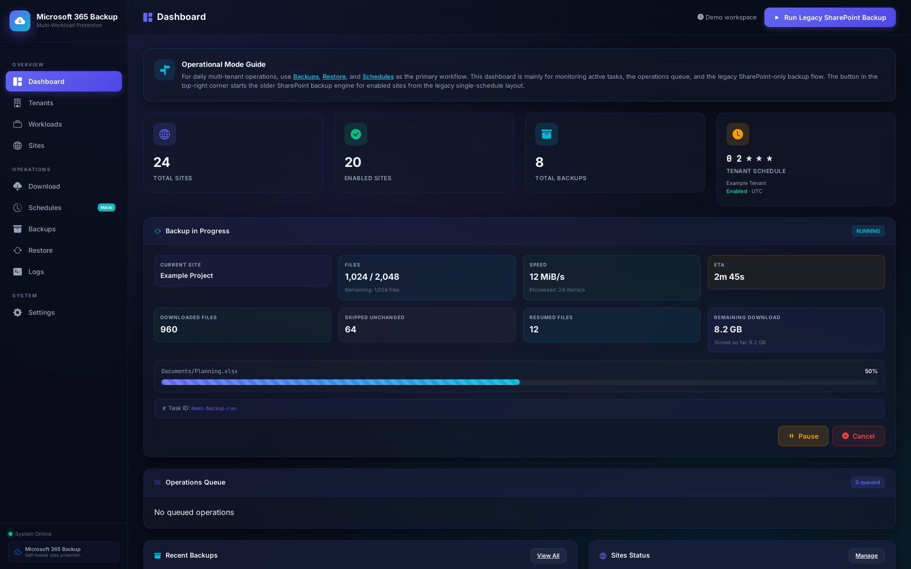

# Microsoft 365 Backup: Application Guide

Deploy and operate the Flask, Celery, and Redis stack for tenant-aware Microsoft 365 backups.

**[Product Overview](../README.md)** · **[Video Tour](../docs/assets/product-tour.mp4)** · **[Workload Support](../docs/WORKLOAD_SUPPORT.md)**



## Deployment

Use a Linux Docker host with Docker Compose. Default services run with UID/GID `1000:1000`; their bind-mounted directories must be writable by that identity.

### Installer: Default Host Paths

```bash
git clone https://github.com/wahyubudiprastowo/Microsoft365-Backup.git
cd Microsoft365-Backup/spo-backup-final
cp .env.example .env
openssl rand -hex 32
nano .env
sh install-fixed.sh
```

Before running the installer, set a unique `SECRET_KEY` and a strong `SPO_ADMIN_PASSWORD`. Sign in at `http://<host>:5050` using `SPO_ADMIN_USERNAME` and that password. Add a tenant under **Tenants**, select workloads and targets, and start with a small selected-target run.

The installer prepares the default sibling directories. It reads UID/GID overrides from its shell environment; if you override them only in `.env`, use the manual procedure below to prepare ownership consistently. Installer status text uses the default port even when you configure a different `SPO_WEB_PORT`.

### Manual Deployment: Custom Storage

Copy `.env.example` to `.env`, edit the paths and credentials, then create the directories and configuration file before starting Docker. Example for the default paths and UID/GID:

```bash
mkdir -p ../config ../data ../logs ../redis
cp -n config.example.json ../config/config.json
sudo chown -R 1000:1000 ../config ../data ../logs ../redis
sudo chmod 750 ../config
sudo chmod 640 ../config/config.json
docker compose build
docker compose up -d
docker compose ps
```

Adapt the paths and ownership to match `.env` when using custom mounts. A configuration bind mount must point to an existing file. Place an HTTPS reverse proxy in front of the web service for access across untrusted networks; the application uses HTTP Basic admin authentication.

## Configuration

| Variable | Default / purpose |
| --- | --- |
| `SECRET_KEY` | Set a unique random value |
| `SPO_ADMIN_USERNAME` | `admin` |
| `SPO_ADMIN_PASSWORD` | Replace the example password before deployment |
| `SPO_WEB_PORT` | `5050` |
| `SPO_UID` / `SPO_GID` | `1000` / `1000` |
| `TZ` | `Asia/Jakarta` |
| `SPO_DATA_DIR` | `../data` → `/backup/sharepoint` |
| `SPO_CONFIG_FILE` | `../config/config.json` → `/app/config.json` |
| `SPO_LOG_DIR` | `../logs` → `/app/logs` |
| `SPO_REDIS_DIR` | `../redis` → Redis `/data` |

Use [config.example.json](config.example.json) and [.env.example](.env.example) as templates. Production config, `.env`, backup payload, logs, and Redis state are excluded from Git. Keep the persistent configuration alongside backup storage in your infrastructure recovery plan.

## Tenant Permissions and Coverage

The application uses Microsoft Graph application credentials. Configure permissions in Entra ID, grant admin consent, then validate the tenant and inspect restore preflight. A read-capable connection does not establish write permission.

| Workload | Backup permissions declared by the app | Restore requirements |
| --- | --- | --- |
| SharePoint | `Sites.Read.All`, `Files.Read.All` | One of `Files.ReadWrite.All`, `Sites.ReadWrite.All`, `Sites.FullControl.All` |
| OneDrive | `Files.Read.All`, `User.Read.All` | `Files.ReadWrite.All` plus user discovery access |
| Outlook | `Mail.Read`, `Calendars.Read`, `Contacts.Read`, `User.Read.All` | `Mail.ReadWrite`, `Calendars.ReadWrite`, `Contacts.ReadWrite`, according to selected items |
| Teams | `Team.ReadBasic.All`, `Channel.ReadBasic.All`, `ChannelMessage.Read.All`, `ChannelSettings.Read.All`, `TeamMember.Read.All`, `Files.Read.All` | Local archive export; no Teams write-back |

This table reflects the workload registry, not a guarantee that every optional Graph endpoint is covered. Teams backup also requests group membership/owners, installed apps, and tabs; those endpoints can require additional permissions. Inspect the run's errors and grant the permissions needed for the selected coverage.

### Recovery Limits

- SharePoint and OneDrive restore files and folders; they do not promise recreation of every service setting, ACL, version, or sharing link.
- Outlook backup discovers directory users as candidates. On-premises, inactive, or inaccessible mailboxes may not be available to the Graph mailbox API.
- Outlook restore recreates messages in `M365 Restored`, plus supported calendar/contact items. It does not recreate the original mailbox folder hierarchy. Direct file-attachment restore currently supports files below 3 MB; unsupported attachments are reported.
- Teams backup includes channel content and files. Recovery exports local HTML/JSON/text archives; private chats and import into a live Team are not implemented.
- A dry run previews work and permission readiness. Validate the complete recovery flow with a test destination for your tenant.

## Operator Workflow

| Menu | Daily use |
| --- | --- |
| Dashboard | Overview and active legacy SharePoint progress |
| Tenants | Configure and validate tenant connections |
| Workloads | Enable workloads, discover targets, save target scope |
| Sites | Manage SharePoint entries and asynchronously refresh size estimates |
| Download | Run selected SharePoint download operations |
| Schedules | Manage tenant-aware cron schedules and recipients |
| Backups | Run enabled workloads and inspect backup inventory |
| Restore | Preview and execute recovery or Teams archive export |
| Logs | Inspect operational events and failures |
| Settings | Configure remote destinations and notification transport |
| Advanced compatibility | Access legacy settings when required |

Prefer tenant-aware **Backups**, **Restore**, and **Schedules** for daily use. The dashboard's legacy SharePoint action follows the older configuration flow.

## Storage and Remote Copies

The registry reads legacy and tenant/workload layouts, including:

```text
/backup/sharepoint/backup_YYYYMMDD_HHMMSS/
/backup/sharepoint/custom_<name>_<timestamp>/
/backup/sharepoint/m365/<tenant-slug>/<workload>/backup_current/
```

Tenant workload engines can reuse `backup_current` and target completion markers. These directories are not immutable dated snapshots; account for that when designing retention and independent copies.

Configure SMB/CIFS, FTP/FTPS, SFTP/SSH, or WebDAV under **Settings**. Select the destination's workload checklist and run **Test Connection** to verify a temporary write. Auto-upload copies the matching workload directory after backup; direct remote restore is not available.

SFTP requires a trusted host key or configured SHA256 fingerprint. Private-key paths refer to files inside the worker container and require a corresponding read-only mount. FTP without TLS is unencrypted. See the [remote storage guide](../docs/REMOTE_STORAGE.md) for protocol-specific verification limits.

## Transfer Performance

The defaults in `.env.example` are starting points, not a bandwidth guarantee. SharePoint's parallel-range path applies to sufficiently large files; other workload downloads may use sequential streams.

| Variable | Default | Purpose |
| --- | --- | --- |
| `GRAPH_DOWNLOAD_CHUNK_SIZE` | `4194304` | Stream chunk size: 4 MiB |
| `GRAPH_DOWNLOAD_RANGE_WORKERS` | `4` | SharePoint large-file range concurrency |
| `GRAPH_DOWNLOAD_RANGE_MIN_SIZE` | `67108864` | Parallel-range threshold: 64 MiB |
| `GRAPH_LIST_PAGE_SIZE` | `999` | Listing page size where supported |
| `HTTP_POOL_CONNECTIONS` | `64` | HTTP connection pool count |
| `HTTP_POOL_MAXSIZE` | `64` | HTTP pool capacity |
| `BACKUP_MANIFEST_FLUSH_EVERY` | `25` | Manifest flush file interval |
| `BACKUP_MANIFEST_FLUSH_INTERVAL` | `5` | Manifest flush time interval in seconds |

Measure transfer throughput, disk I/O, CPU, and Graph throttling on representative files before tuning. More concurrency can increase throttling. Apply environment changes during an idle maintenance window by recreating the relevant services; avoid interrupting an active worker.

## Operations and Updates

Run from `spo-backup-final/`:

```bash
docker compose ps
docker compose logs -f spo-backup
docker compose logs -f celery-worker
docker compose logs -f celery-restore-worker
docker compose logs -f celery-estimate-worker
docker compose logs -f celery-beat
curl -fsS http://localhost:5050/api/health
```

Before upgrading, wait for active jobs to finish and preserve local modifications. Back up configuration and persistent data, review changes, then:

```bash
git pull --ff-only
docker compose build
docker compose up -d
docker compose ps
```

The health endpoint confirms the web service responds. Use worker logs and an actual selected-target operation to verify Graph access and storage writes.

## Development and Validation

| Source | Responsibility |
| --- | --- |
| `app/main.py`, `app/main_routes*.py` | UI and API routes |
| `app/tasks.py` | Background orchestration and progress |
| `app/backup_engine.py` | SharePoint transfer engine |
| `app/workloads/` | Workload discovery and backup |
| `app/restore/`, `app/restore_manager_v2.py` | Recovery and preflight |
| `app/uploader.py` | Remote destinations |
| `app/backup_registry.py` | Backup inventory |
| `app/templates/` | Operator interface |

After building and starting Compose, run the current unit suite using the application image:

```bash
docker run --rm --network spo-backup-net \
  --entrypoint python -e PYTHONPATH=/app \
  -v "$PWD/tests:/app/tests:ro" spo-backup:v4 \
  -m unittest discover -s /app/tests -p 'test_*.py'
```

One existing test reads Redis state; this command therefore uses the Compose network. Run against a dedicated development stack when changing queue/state logic. Automated tests mostly use mocked Graph/remote clients and temporary files; they do not replace a controlled backup-and-restore integration test.

Documentation PNGs use synthetic data rendered from the application templates.
To regenerate them, install `Jinja2` and `playwright` in a documentation-only
environment, install Playwright's Chromium browser, and run
`python ../docs/assets/render-demo-screenshots.py`. This renderer reads only
templates and fixed demo fixtures; it does not import the app or connect to a tenant.

To regenerate the README tour with FFmpeg installed:

```bash
sh ../docs/assets/build-product-tour.sh
```

See the [root README](../README.md#build-with-us) for contribution guidance and the [workload support guide](../docs/WORKLOAD_SUPPORT.md) for validation steps and remaining limitations.
